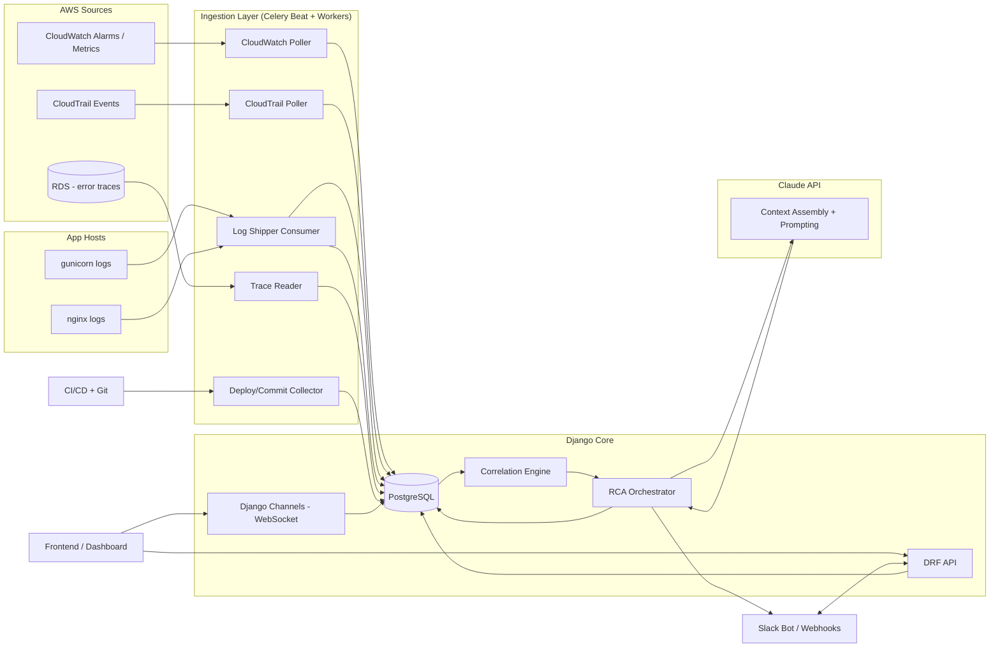

# Production Incident Assistant — Architecture Specification

## 1. Overview

The Production Incident Assistant is a Django-based system that ingests signals from
AWS CloudWatch/CloudTrail, application logs (gunicorn/nginx), error traces, deployment
history, and recent commits, then uses an LLM (Claude) to correlate that data into a
root-cause analysis (RCA) for production incidents. It surfaces incidents and RCA
output in near real-time via a REST API, WebSocket updates, and Slack notifications.

**Goals**
- Automatically detect and open incidents from CloudWatch alarms/anomalies.
- Aggregate the surrounding context (logs, traces, deploys, commits) for a given time window.
- Use Claude to produce a running incident summary, likely root cause(s), and suggested
  next diagnostic steps.
- Notify and update responders in Slack.
- Provide an audit trail for postmortems.

**Non-goals (v1)**
- Two-way sync back to AWS/PagerDuty/Opsgenie (see §10, Future Work).
- Auto-remediation / running fixes.
- Multi-cloud support (AWS-only for v1).

---

## 2. High-Level Architecture



**Flow summary:** Alarms and signals land in Postgres via scheduled/streamed ingestion
jobs → the Correlation Engine groups related signals into an `Incident` and time-windows
the supporting data → the RCA Orchestrator assembles that context into a prompt for
Claude → the response (summary, likely cause, next steps) is stored and pushed to
Slack and connected clients over WebSocket.

---

## 3. Core Components

### 3.1 Ingestion Layer
Implemented as Celery tasks, scheduled via Celery Beat or triggered by events.

| Component | Source | Mechanism | Cadence |
|---|---|---|---|
| CloudWatch Poller | CloudWatch Alarms, Metric Anomaly Detection | boto3 `describe_alarms`, EventBridge → SQS → Celery task (preferred over polling where possible) | Event-driven via EventBridge, fallback poll every 60s |
| CloudTrail Poller | CloudTrail (management + data events relevant to deploys/config changes) | boto3 `lookup_events`, or CloudTrail → S3 → SQS | Poll every 2–5 min |
| Log Shipper Consumer | gunicorn/nginx logs | Agent (e.g., Fluent Bit / CloudWatch Agent) ships logs to CloudWatch Logs; Django consumes via Logs Insights query or subscription filter → Kinesis/SQS → Celery | Streaming or 1 min batch |
| Trace Reader | RDS table(s) storing app error traces | Direct read replica query or logical replication into local `LogEntry` table | Poll every 30–60s, or DB trigger/CDC if available |
| Deploy/Commit Collector | ASG Instance Refresh (AMI-based manual deploys) | Native EventBridge event `EC2 Instance Refresh Succeeded` → SQS → Celery task; commit SHA read from a tag on the AMI/launch template set at backup time | Event-driven (EventBridge), backfill on startup |

All ingestion tasks are idempotent (dedup by source event ID) and write into a common
normalized event store so the Correlation Engine doesn't need to know about source-specific formats.

**Deploy ingestion — current process (AMI + Instance Refresh):** The deploy process is
manual: an engineer backs up an AMI from the running EC2s, registers it as a new
Launch Template version, and triggers an **ASG Instance Refresh** to roll it out. The
system listens for the native EventBridge event `source: aws.autoscaling`,
`detail-type: "Instance Refresh Succeeded"` (no CloudTrail needed — this is a purpose-
built ASG lifecycle event). The rule targets an SQS queue that a Celery task polls.
Authentication is via IAM (the EventBridge rule/target's own permissions), so **no
shared secret or webhook verification is needed** for this source — it's handled the
same way as the CloudWatch/CloudTrail pollers, not as an inbound webhook.

Since an ASG launch template carries no inherent code-version information, the AMI
(or the launch template version) **must be tagged with the commit SHA** at backup
time, e.g.:

```bash
aws ec2 create-tags --resources <ami-id> --tags Key=CommitSHA,Value=<sha>
```

The Celery task reads this tag off the AMI associated with the succeeded refresh to
populate `Deployment.commit_sha`.

> **Process dependency — please read:** this signal only fires if a deploy actually
> goes through an Instance Refresh. A deploy done by directly SSHing into instances and
> restarting services (bypassing AMI/launch-template/refresh entirely) produces no
> AWS-native signal and will not appear in the system. Similarly, registering a new
> AMI/launch template *without* triggering a refresh does not count as a deploy — the
> new template just sits there until something refreshes the ASG. This is a known,
> accepted limitation: the "recent deployments" context feeding RCA is only as
> complete as the team's adherence to the Instance Refresh flow. A raw webhook
> fallback (`POST /api/webhooks/deploy/`, secured via `DEPLOY_WEBHOOK_SECRET` as a
> bearer-token comparison) is available for one-off exceptions but is not treated as
> a reliable primary source.

### 3.1.1 Migration Path: CodePipeline + CodeBuild

Once deployments move to CodePipeline + CodeBuild (no CodeDeploy), the deploy
collector gets simpler and more reliable, and the process-dependency caveat above
mostly goes away:

- **Trigger**: EventBridge rule on `source: aws.codepipeline`, `detail-type:
  "CodePipeline Pipeline Execution State Change"`, filtered to `state: SUCCEEDED`
  (optionally also `source: aws.codebuild` / `"CodeBuild Build State Change"` if you
  want build-level granularity, e.g. to catch failed builds too). Same SQS → Celery
  pattern, same IAM-based auth — this is a drop-in replacement for the Instance
  Refresh listener, not a new architectural pattern.
- **Commit SHA comes for free**: the pipeline execution's source-stage output artifact
  already carries the commit SHA (from CodeCommit, if that's the source repo — see
  below), so there's no need to tag an AMI manually. The Celery task reads it directly
  from the pipeline execution detail via `codepipeline:GetPipelineExecution`.
- **Signal reliability improves**: because a deploy *is* a pipeline execution, there's
  no equivalent of "AMI registered but never rolled out" — a `SUCCEEDED` pipeline
  execution means the deploy actually happened, end to end. This removes the biggest
  caveat of the current Instance Refresh approach.
- **If source control is CodeCommit**: commit metadata (author, message, files
  changed) can be fetched natively via `boto3` (`codecommit:GetCommit`,
  `GetDifferences`) using IAM, rather than a Git provider API token — one less
  credential to manage compared to GitHub/GitLab.
- **What changes in the codebase**: only `ingestion/deploys.py` and its EventBridge
  rule/SQS wiring change — the `Deployment`/`Commit` models, the Correlation Engine,
  and the RCA Orchestrator are unaffected, since they consume the same normalized
  `Deployment`/`Commit` rows regardless of which ingestion adapter populated them.
- **Net effect**: this migration is a pure win for the assistant's accuracy — it
  doesn't just simplify the architecture, it closes the "did the team follow the
  process" gap that Instance Refresh-based tracking depends on today.

### 3.2 Data Model (PostgreSQL)

Core tables (simplified):

- **Incident** — `id, title, status (open/investigating/mitigated/resolved), severity, opened_at, resolved_at, slack_channel_id`
- **AlertEvent** — `id, incident_id (nullable until correlated), source (cloudwatch/cloudtrail), raw_payload (JSONB), fingerprint, occurred_at`
- **LogEntry** — `id, incident_id (nullable), source (gunicorn/nginx/rds_trace), level, message, raw_payload (JSONB), occurred_at`
- **Deployment** — `id, service, version, commit_sha, deployed_at, deployed_by, status`
- **Commit** — `id, sha, author, message, files_changed (JSONB), committed_at, deployment_id (nullable)`
- **RCAReport** — `id, incident_id, summary, likely_root_causes (JSONB), suggested_next_steps (JSONB), llm_model, prompt_context_ref, created_at`
- **SlackNotification** — `id, incident_id, channel, message_ts, notification_type, sent_at`

Indexes on `occurred_at`, `fingerprint`, and `incident_id` across event tables to support
fast time-windowed correlation queries.

### 3.3 Correlation Engine

Given a new `AlertEvent` (typically a CloudWatch alarm transitioning to ALARM state):

1. Check for an existing open `Incident` with overlapping fingerprint/service within a
   configurable dedup window (e.g., 10 min) — attach to it if found.
2. Otherwise open a new `Incident`.
3. Pull correlated context within a time window around the alert (default: 15 min
   before → ongoing), across `LogEntry`, `Deployment`, `Commit`, and other `AlertEvent`
   rows scoped to the same service/tag.
4. Enqueue an `RCAOrchestrator` Celery task with the incident ID.

### 3.4 RCA Orchestrator + Claude Integration

- Assembles a bounded context package: incident metadata, recent alarm payloads
  (summarized/truncated), a sample of relevant log lines (errors/warnings prioritized,
  deduplicated by message pattern), the most recent deployment(s) and their commits.
- Enforces a token budget — long log windows are pre-summarized or sampled
  before being sent to Claude to avoid oversized prompts.
- Calls the Claude API (`claude-sonnet-4-6` by default, configurable) with a
  structured system prompt requesting JSON output: `{summary, likely_root_causes[],
  confidence, suggested_next_steps[], relevant_evidence[]}`.
- Persists the response as an `RCAReport` linked to the `Incident`.
- On subsequent correlated events for the same open incident, re-runs with updated
  context (rate-limited, e.g., no more than once per 2 minutes) and posts an update.

### 3.5 API Layer (Django REST Framework)

- `GET/POST /api/incidents/` — list/create incidents
- `GET /api/incidents/{id}/` — incident detail incl. latest RCA report
- `GET /api/incidents/{id}/timeline/` — merged, time-ordered view of alerts/logs/deploys
- `POST /api/incidents/{id}/status/` — update status (ack/investigating/resolved)
- `GET /api/incidents/{id}/rca/` — RCA report(s) history
- `POST /api/webhooks/cloudwatch/` — EventBridge → API Destination target (alternative to polling)
- `POST /api/webhooks/deploy/` — CI/CD deploy-completed webhook
- `POST /api/webhooks/slack/` — Slack slash commands / interactivity endpoint

Authentication: service-to-service via signed webhooks (HMAC) + IAM where applicable;
human users via DRF token or session auth (SSO-ready).

### 3.6 Real-Time Layer (Django Channels)

- ASGI server (Daphne/Uvicorn) alongside Celery.
- Redis as the channel layer backend (same Redis instance can back Celery broker,
  logically separated by DB index or a dedicated instance in production).
- Consumers push incident status changes and new RCA report events to subscribed
  dashboard clients over WebSocket (`/ws/incidents/{id}/`).

### 3.7 Slack Integration

- Slack Bot (Bolt for Python or `slack_sdk`) running as part of the Django app or a
  small adjacent service.
- On incident creation: posts to a configured channel (or creates a dedicated incident
  channel), including the initial Claude-generated summary.
- On RCA update: posts a threaded follow-up.
- Slash command (e.g., `/incident status`, `/incident ack`) hits
  `POST /api/webhooks/slack/`, which updates the `Incident` and echoes confirmation.

---

## 4. Incident Lifecycle

1. **Detect** — CloudWatch alarm fires → ingested as `AlertEvent`.
2. **Correlate** — Correlation Engine opens/attaches to an `Incident`, gathers context.
3. **Diagnose** — RCA Orchestrator calls Claude, stores `RCAReport`.
4. **Notify** — Slack message posted with summary + suggested next steps.
5. **Investigate** — Responders view timeline/RCA via API/dashboard, update status.
6. **Resolve** — Incident marked resolved; final RCA snapshot retained for postmortem.
7. **Postmortem (manual/future)** — Export incident timeline + RCA history as a report.

---

## 5. Security & Secrets

- AWS access via least-privilege IAM role (read-only: `cloudwatch:Describe*`,
  `cloudtrail:LookupEvents`, `logs:FilterLogEvents`, `logs:GetQueryResults`).
- RDS trace table access via a read-only DB user, ideally a read replica.
- Claude API key and Slack tokens stored in environment variables locally, AWS Secrets
  Manager / SSM Parameter Store in deployed environments — never committed.
- Webhook endpoints (Slack, deploy) verify signatures (Slack signing secret, HMAC for
  CI/CD webhooks).
- PII/secret scrubbing pass on log lines and commit metadata before they're included
  in any Claude prompt (regex-based redaction for common secret/token patterns).

---

## 6. Tech Stack

| Layer | Choice |
|---|---|
| Framework | Django + Django REST Framework |
| Real-time | Django Channels (ASGI), Redis channel layer |
| Database | PostgreSQL |
| Task queue | Celery + Redis (broker & result backend) |
| Scheduler | Celery Beat |
| LLM | Claude API (`claude-sonnet-4-6`, configurable) |
| Chat | Slack (Bolt/`slack_sdk`) |
| AWS access | boto3 |
| Local deploy | Docker Compose |
| Future deploy | AWS ECS on Fargate |

---

## 7. Local Development Topology (Docker Compose)

Services: `web` (Django/ASGI), `worker` (Celery), `beat` (Celery Beat), `db`
(Postgres), `redis`, and optionally `localstack` for mocking CloudWatch/CloudTrail/S3
during development without touching real AWS resources.

---

## 8. Future Deployment (ECS on Fargate)

- Separate Fargate services for `web` (ASGI behind ALB), `worker`, and `beat`.
- RDS Postgres (managed) replacing the Compose `db` service.
- ElastiCache Redis replacing the Compose `redis` service.
- Secrets via Secrets Manager, injected as task-definition secrets.
- CloudWatch Logs for the app's own logs (separate from the logs it ingests).

---

## 9. Cost Control & Rate Limiting (LLM Calls)

Alert storms (a bad deploy, an AZ outage, a cascading failure) can generate hundreds of
`AlertEvent` rows in a single minute. Without safeguards, a naive "call Claude per
event" design would turn a 500-alert storm into 500 API calls. The system enforces
several layered defenses so that a storm collapses into a small, bounded number of
LLM calls.

### 9.1 Dedup at the source (primary defense)

No `AlertEvent` calls the RCA Orchestrator directly. Only a **state transition** on an
`Incident` — new incident opened, or an existing open incident receiving materially new
evidence — is allowed to enqueue an RCA task. The Correlation Engine's fingerprinting
(§3.3) means 500 repeats of the same flapping alarm collapse into one open incident
before cost even becomes a question.

### 9.2 Debounce window on incident creation

When an `Incident` is first opened, the RCA task is scheduled with a short delay
(e.g., `apply_async(countdown=45)`) rather than fired immediately, so correlated
evidence arriving in the same burst is gathered into a single context instead of
triggering one call per event. Each new correlated event bumps an
`Incident.debounce_token` (a UUID or incrementing int); when the delayed task fires, it
compares its captured token against the current value and no-ops if a newer one has
superseded it — only the last scheduled task in a burst actually runs.

```python
# incidents/models.py
class Incident(models.Model):
    ...
    debounce_token = models.UUIDField(default=uuid.uuid4)
    last_rca_at = models.DateTimeField(null=True, blank=True)
    rca_run_count = models.PositiveIntegerField(default=0)
```

```python
# incidents/tasks.py
@shared_task
def maybe_run_rca(incident_id, token):
    incident = Incident.objects.get(id=incident_id)
    if str(incident.debounce_token) != token:
        return  # superseded by a newer event in the same burst
    run_rca_for_incident.delay(incident_id)
```

### 9.3 Per-incident cooldown

Independent of the debounce, an `Incident` may not trigger more than one RCA run per
`RCA_MIN_INTERVAL_SECONDS` (default 120s), checked against `last_rca_at` before
enqueueing, and capped at `RCA_MAX_RUNS_PER_INCIDENT` (default 5) for its lifetime.
Once the cap is hit, new evidence still accumulates for the timeline/postmortem, but
auto-triggered RCA stops; a responder can force one more via the Slack command
`/incident rca`.

### 9.4 Global circuit breaker

A Redis-backed sliding-window counter tracks Claude calls (and optionally tokens)
system-wide per minute:

```
INCR llm:calls:{minute_bucket}
EXPIRE llm:calls:{minute_bucket} 120
```

If the count crosses `LLM_CIRCUIT_BREAKER_THRESHOLD` (e.g., 20 calls/min), the RCA
Orchestrator stops auto-triggering entirely for the remainder of the window, and a
single Slack message is posted: *"⚠️ High alert volume — RCA auto-generation paused.
Reply `/incident rca` on a specific incident to force a run."* This is the backstop for
genuinely unrelated concurrent incidents (rare, but not impossible) that dedup and
per-incident cooldowns wouldn't catch on their own.

### 9.5 Cheap pre-filter before the expensive call

Before invoking Claude, hash the assembled context package (alerts + log sample +
deploys/commits within the window). If the hash matches the hash stored on the
incident's last `RCAReport`, skip the call — nothing material has changed since the
last run. This catches the case where a debounce/cooldown window still elapses but the
evidence gathered is identical to what was already analyzed.

### 9.6 Fingerprint-based RCA caching

For recurring, previously-diagnosed issues, cache the most recent `RCAReport` keyed by
`fingerprint` with a short TTL (e.g., 1 hour) in Redis. A new incident matching a
recently-seen fingerprint can be served the cached summary immediately (labeled
"similar to incident #X, generated Ny ago") while a fresh RCA run is optionally still
queued in the background at normal cooldown pace, rather than needed synchronously.

### 9.7 Token budgeting per call

Independent of call *frequency*, the Context Builder (§3.4) caps what is sent per
call — log sampling/deduplication by message pattern, truncation of alarm payloads —
and the API request itself sets a tight `max_tokens` since the expected output is
structured JSON, not free-form prose.

### 9.8 Configuration surface

| Setting | Default | Purpose |
|---|---|---|
| `RCA_DEBOUNCE_SECONDS` | 45 | Delay before first RCA run on a new incident |
| `RCA_MIN_INTERVAL_SECONDS` | 120 | Minimum time between RCA runs on the same incident |
| `RCA_MAX_RUNS_PER_INCIDENT` | 5 | Lifetime cap on auto-triggered RCA runs per incident |
| `LLM_CIRCUIT_BREAKER_THRESHOLD` | 20/min | Global calls-per-minute before auto-RCA pauses system-wide |
| `RCA_CACHE_TTL_SECONDS` | 3600 | TTL for fingerprint-keyed cached RCA reports |
| `RCA_MAX_CONTEXT_TOKENS` | (model-dependent) | Upper bound enforced by the Context Builder before sending |

**Net effect:** a 500-alert storm from a single root cause is collapsed by fingerprinting
and debouncing into effectively one incident and one RCA call; the per-incident cooldown
and global circuit breaker bound the worst case (many *genuinely distinct* concurrent
incidents) so LLM spend degrades gracefully instead of scaling linearly with alert volume.

---

## 10. Observability of the Assistant Itself

- The assistant's own errors/logs should ship to CloudWatch like any other service,
  but are tagged distinctly so they aren't accidentally ingested as *subject* data.
- Track Claude API latency/cost/token usage per RCA call for budgeting.
- Track ingestion lag (time from source event to `AlertEvent` row creation) per source.

---

## 11. Future Work

- **Two-way sync**: acknowledge/close CloudWatch alarms, sync incident status to
  PagerDuty/Opsgenie, annotate CloudTrail-adjacent resources.
- **Additional sources**: Sentry, Datadog, Prometheus/Alertmanager.
- **Auto-suggested runbook links** based on historical incident similarity.
- **Postmortem doc generation** (Claude-drafted, human-edited).
